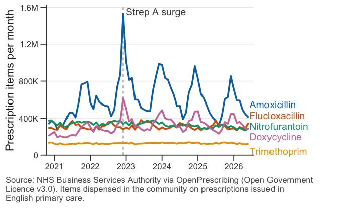
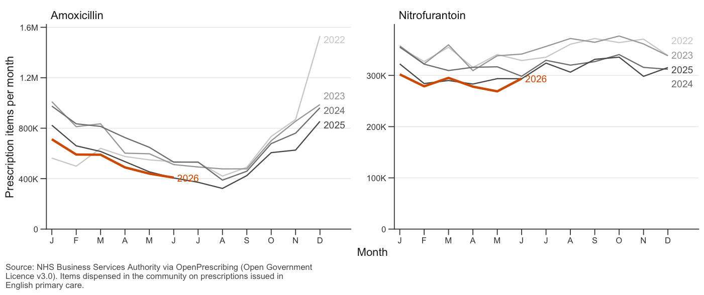

<!-- README.md is generated from README.Rmd. Please edit that file and re-knit with devtools::build_readme(). -->

# opamr

<!-- badges: start -->

[](https://github.com/vargasrichards/opamr/actions/workflows/R-CMD-check.yaml)
[](https://vargasrichards.github.io/opamr/)
[](LICENSE.md)
<!-- badges: end -->

**opamr** retrieves English primary-care antibiotic prescribing data
from [OpenPrescribing](https://openprescribing.net/api/), translates
between the vocabularies used in prescribing and resistance data (BNF
codes, ATC codes, [`AMR`](https://amr-for-r.org/) package codes and drug
names), and draws publication-quality `ggplot2` figures.

|  |  |
|----|----|
| **Crosswalk** | `ab_to_bnf()`, `bnf_to_ab()`, `atc_to_bnf()`, `bnf_to_atc()`, `op_antibiotics()`, `bnf_class()`. Uses a bundled table of 121 BNF chemicals and works offline. |
| **Data** | `op_spending()` and `op_spending_ab()` (monthly items, quantity and cost nationally or by Sub-ICB Location, ICB, PCN or practice); `op_org_details()`, `op_rate()` and `op_antibiotic_use()` (list-size and STAR-PU rates); `op_bnf_search()` and `op_org_search()` |
| **Figures** | `op_plot_trend()`, `op_plot_seasonal()`, `op_plot_distribution()`, `op_plot_heatmap()`, `theme_op()`, `op_save()` |

## Installation

``` r
# install.packages("remotes")
remotes::install_github("vargasrichards/opamr")
```

`AMR` is optional. It lets free-text names, brand names and misspellings
be resolved.

## Example

``` r
library(opamr)

# antimicrobial names, AMR codes and ATC codes -> BNF chemical codes
ab_to_bnf(c("co-amoxiclav", "NIT", "J01AA02"), use_amr = FALSE)[, c("input", "ab", "atc", "bnf_chemical_code")]
#>          input  ab     atc bnf_chemical_code
#> 1 co-amoxiclav AMC J01CR02         0501013K0
#> 2          NIT NIT J01XE01         0501130R0
#> 3      J01AA02 DOX J01AA02         0501030I0
#> 4      J01AA02 DOX J01AA02         0501030Z0

# a whole class by ATC prefix
ab_to_bnf("J01MA", output = "codes")
#> [1] "0501120L0" "0501120P0" "0501120Q0" "0501120X0" "0501120Y0"

# any BNF code (here a 15-character presentation) -> antimicrobial
bnf_to_ab("0501013B0AAAAAA")[, c("input", "ab", "ab_name", "atc")]
#>             input  ab     ab_name     atc
#> 1 0501013B0AAAAAA AMX Amoxicillin J01CA04
```

Download prescribing (needs network access):

``` r
use  <- op_spending_ab(c("amoxicillin", "nitrofurantoin", "doxycycline"))               # England, monthly
rate <- op_antibiotic_use("amoxicillin", org_type = "sicbl",
                          denominator = "star_pu.oral_antibacterial_items")              # every Sub-ICB Location
```

Figures from the bundled national example data:

``` r
top <- op_example[op_example$ab_name %in% c("Amoxicillin", "Doxycycline", "Nitrofurantoin",
                                            "Flucloxacillin", "Trimethoprim"), ]
op_plot_trend(top, y = "items", events = data.frame(date = "2022-12-01", label = "Strep A surge"))
```



``` r
op_plot_seasonal(top[top$ab %in% c("AMX", "NIT"), ], y = "items", years = 2022:2026)
```



``` r
p <- op_plot_trend(top, y = "items")
op_save(p, "figure1.pdf", width = "single")   # 85 mm; "onehalf" 120 mm; "double" 178 mm
```

## Documentation

- [Getting started](https://vargasrichards.github.io/opamr/articles/opamr.html)
- [Antimicrobial names, AMR codes, ATC codes and BNF
  codes](https://vargasrichards.github.io/opamr/articles/crosswalk.html)
- [Retrieving data from
  OpenPrescribing](https://vargasrichards.github.io/opamr/articles/api.html)
- [Publication-quality
  figures](https://vargasrichards.github.io/opamr/articles/figures.html)
- [Function reference](https://vargasrichards.github.io/opamr/reference/)

## Data and limitations

- **What the data cover.** Prescription items dispensed in the community
  on prescriptions issued in English primary care. Data are monthly,
  with a lag of about two months. Hospital inpatient use is not
  included. There are no indications, doses or patient identifiers.
- **Licence and citation.** The data are published by the NHS Business
  Services Authority under the Open Government Licence v3.0, and served
  by OpenPrescribing (Bennett Institute for Applied Data Science,
  University of Oxford). Cite both.
- **How `antibiotic_crosswalk` was built.** BNF chemical names from the
  English Prescribing Dataset were matched to `AMR` codes with
  `AMR::as.ab()`. Matches were filtered to reject false positives, and a
  reviewed override table was applied. Chemicals not dispensed in the
  community during the build months are absent. Antivirals and
  antiparasitics are out of scope. `data-raw/build_crosswalk.R` rebuilds
  the table.
- **Where `op_example` comes from.** National monthly totals for BNF
  section 5.1, aggregated from the English Prescribing Dataset
  (`data-raw/build_example.R`). They were not downloaded through the
  API.
- **Testing of the API functions.** They are tested against mocked
  responses with the structure used in the OpenPrescribing server
  source. Live-API tests exist but are off by default: set
  `OPAMR_LIVE_TESTS=true` to run them. OpenPrescribing sits behind bot
  protection, which rejects some automated clients. If you see an “HTML
  page” error, see `?op_check_api`.
