# Publication-quality figures

The figure functions return ordinary `ggplot2` objects, so they can be
modified with `+`. They share these defaults:

- **Colour.** The Okabe-Ito palette, which stays distinguishable under
  the common forms of colour-vision deficiency. No red/green contrasts
  are used.
- **Direct labels.** Series are named at the end of their line, not in a
  legend. Labels are moved apart so they do not overlap, and kept inside
  the panel.
- **Three font sizes.** 8 pt for titles and axis titles, 7 pt for labels
  and legends, and 6 pt for tick labels. All three scale with
  `base_size`.
- **Axes.** Linear axes start at zero. Date breaks stay within the data,
  and tick labels use k/M suffixes.
- **Source caption.** Cites the NHS Business Services Authority,
  OpenPrescribing and the licence. Turn it off with `source = FALSE` or
  replace it with your own text.
- **Journal sizes.**
  [`op_save()`](https://OWNER.github.io/opamr/reference/op_save.md)
  writes at 85, 120 or 178 mm wide, at 300 dpi for raster formats.

All examples use the bundled `op_example` data (national items by
month).

## Time series: `op_plot_trend()`

``` r

op_plot_trend(ex, y = "items")
```

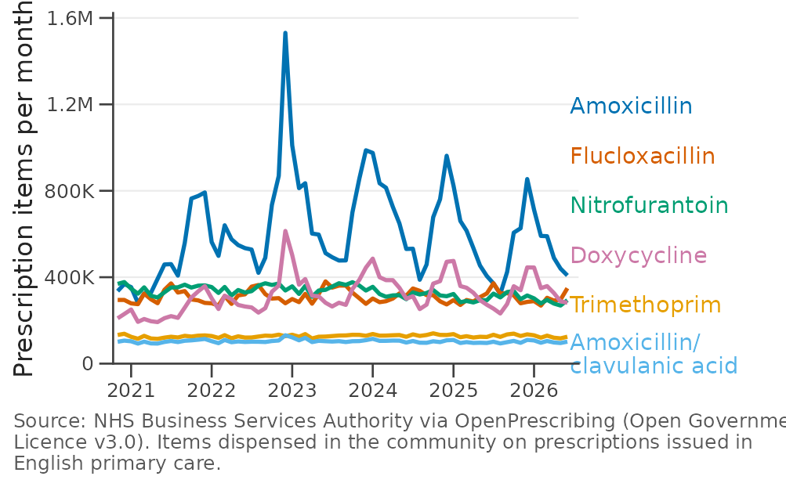

### Many series: highlight a few

If there are more series than colours, the series with the highest final
values are coloured and labelled, up to `max_groups` (default 8). The
others are drawn in light grey as context. Choose them yourself with
`highlight`. A log axis keeps rare agents visible:

``` r

op_plot_trend(op_example, y = "items", log = TRUE,
              highlight = c("Amoxicillin", "Nitrofurantoin", "Clarithromycin", "Cefalexin"))
```

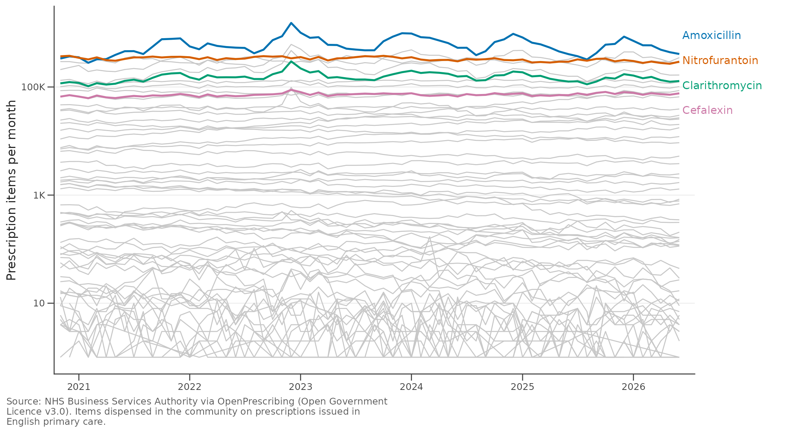

### Small multiples

Pass `facet` with no `group` to get one single-colour panel per agent.
Each panel has its own y-axis, so the trend is visible whatever the
volume:

``` r

op_plot_trend(ex, y = "items", facet = "ab_name")
```

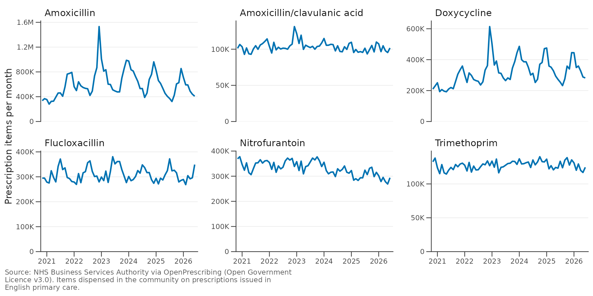

### Marking events

``` r

op_plot_trend(ex[ex$ab_name %in% c("Amoxicillin", "Doxycycline"), ], y = "items",
              events = data.frame(date = "2022-12-01", label = "Strep A surge"),
              title = "Amoxicillin and doxycycline peaked in December 2022")
```

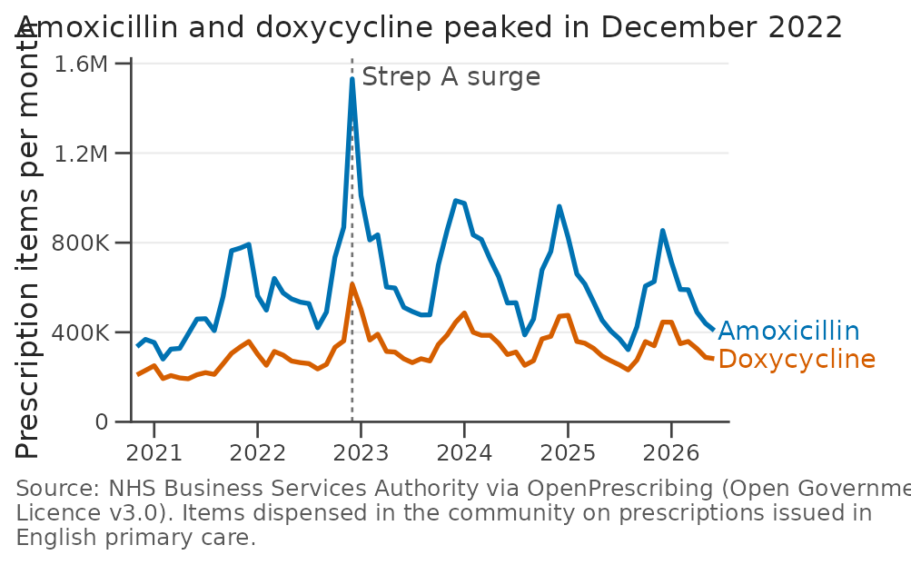

Titles are `NULL` by default. If you add one, make it state the finding,
as above.

## Seasonality: `op_plot_seasonal()`

Months run along the x-axis and each line is one calendar year. Earlier
years are drawn in graded grey and the latest year in colour, so the
seasonal shape and the change between years can be read together:

``` r

op_plot_seasonal(ex[ex$ab_name %in% c("Amoxicillin", "Nitrofurantoin", "Doxycycline", "Trimethoprim"), ],
                 y = "items", years = 2022:2026)
```

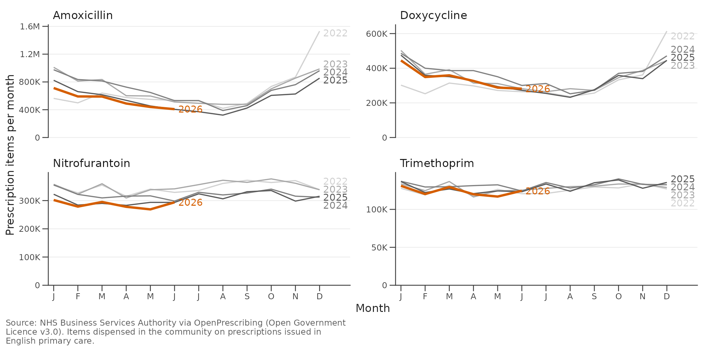

Amoxicillin and doxycycline, used mainly for respiratory infections,
have a winter peak. Nitrofurantoin and trimethoprim, used for urinary
tract infections, are almost flat across the year.

## Variation between organisations: `op_plot_distribution()`

With data for many organisations, such as all Sub-ICB Locations from
`op_antibiotic_use(..., org_type = "sicbl")`, this function draws the
median with 25th–75th and 5th–95th percentile bands per month. Selected
organisations can be overlaid as labelled lines. Plot a **rate**, not
counts, so organisations of different sizes can be compared.

The example below uses **simulated** organisations, because the bundled
data are national only:

``` r

set.seed(2024)
sim <- expand.grid(date = seq(as.Date("2023-01-01"), by = "month", length.out = 30),
                   org_id = sprintf("S%02d", 1:60), stringsAsFactors = FALSE)
sim$org_name <- paste("Sub-ICB", sim$org_id)
season <- 8 * cos(2 * pi * (as.integer(format(sim$date, "%m")) - 1) / 12)
sim$rate <- 45 + season + rnorm(60, 0, 6)[match(sim$org_id, unique(sim$org_id))] + rnorm(nrow(sim), 0, 2)
op_plot_distribution(sim, y = "rate", highlight = c("S07", "S42"), source = FALSE,
                     ylab = "Items per 1,000 patients per month (simulated)")
```

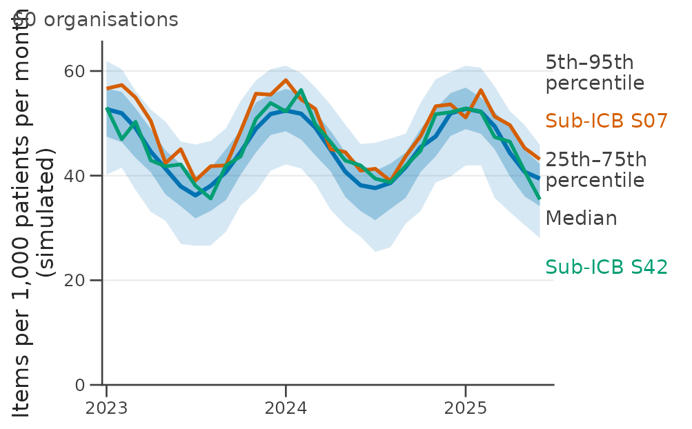

## Heatmap: `op_plot_heatmap()`

Each tile is colour-coded by its value relative to the drug’s own
median, on a log scale centred at 1×. Drugs whose volumes differ a
hundredfold can therefore share one colour scale, and seasonality and
step changes stand out:

``` r

op_plot_heatmap(ex, y = "items")
```

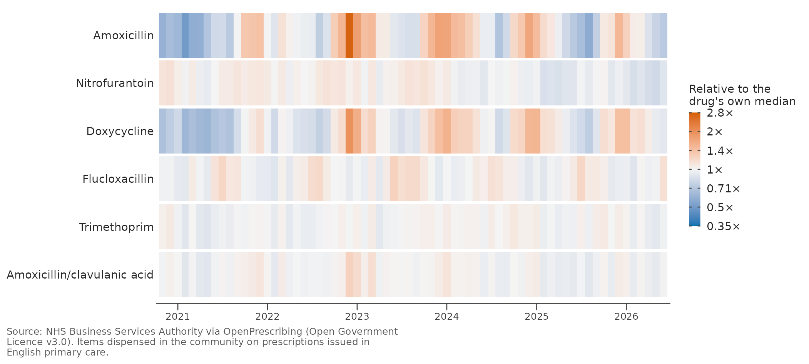

Use `scale = "none"` to colour by raw values instead (the cividis colour
map, which is perceptually uniform). This suits rows of similar size.
Here amoxicillin’s December 2022 peak takes up most of the colour range,
which is why `"ratio"` is the default:

``` r

op_plot_heatmap(ex, y = "items", scale = "none", order_by = "name")
```

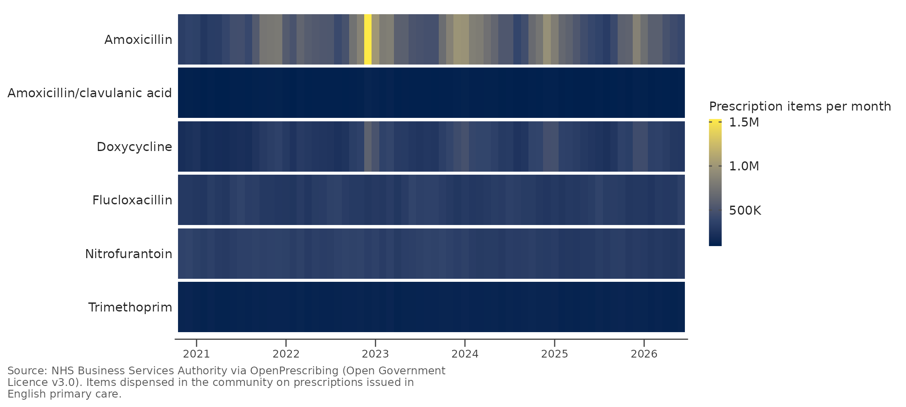

## Rates and axis labels

When [`op_rate()`](https://OWNER.github.io/opamr/reference/op_rate.md)
(or
[`op_antibiotic_use()`](https://OWNER.github.io/opamr/reference/op_antibiotic_use.md))
adds a `rate` column, it records the rate definition. The plot functions
use that definition as the y-axis label. The list size below is an
illustrative constant, not real data:

``` r

amx <- op_example[op_example$ab == "AMX", ]
den <- data.frame(date = amx$date, org_id = "england", total_list_size = 63e6)
amx_rate <- op_rate(amx, den)
op_plot_trend(amx_rate, y = "rate")
```

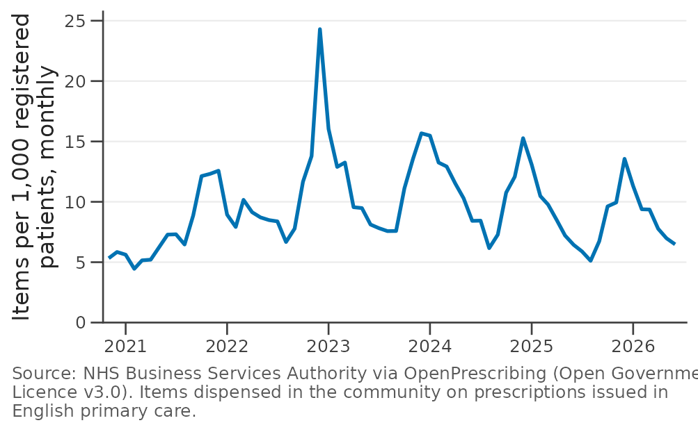

## Customising

The plots are ordinary `ggplot2` objects:

``` r

op_plot_trend(ex, y = "actual_cost", highlight = c("Amoxicillin", "Nitrofurantoin")) +
  ggplot2::labs(y = "Monthly cost (\u00a3)")
```

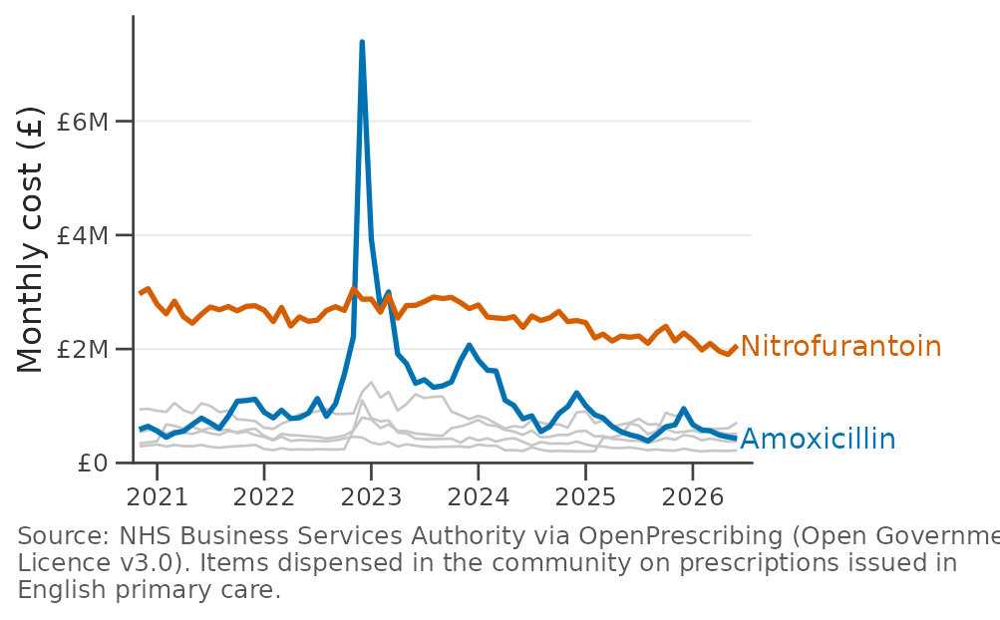

[`theme_op()`](https://OWNER.github.io/opamr/reference/theme_op.md) and
[`scale_colour_op()`](https://OWNER.github.io/opamr/reference/scale_colour_op.md)
can also be used on your own plots:

``` r

library(ggplot2)
yr <- aggregate(items ~ ab_name + year, data = transform(ex, year = format(date, "%Y")), FUN = sum)
yr <- yr[yr$year %in% c("2021", "2025"), ]
ggplot(yr, aes(items / 1e6, reorder(ab_name, items), colour = year)) +
  geom_line(aes(group = ab_name), colour = "grey70") +
  geom_point(size = 2) +
  scale_colour_op(name = NULL) +
  labs(x = "Items per year (millions)", y = NULL) +
  theme_op()
```

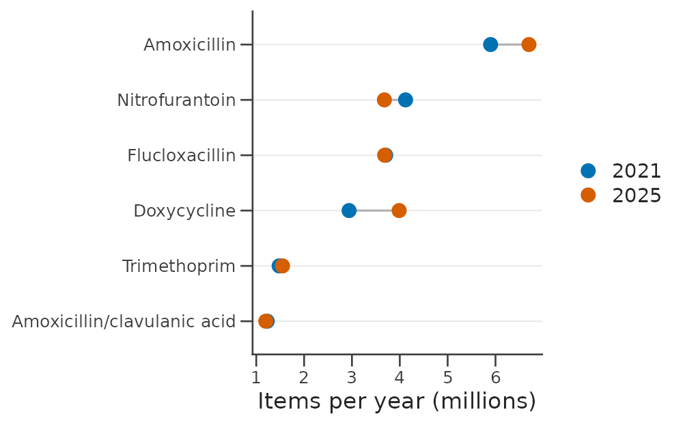

## Saving

``` r

p <- op_plot_seasonal(ex, y = "items", years = 2022:2026)
op_save(p, "fig2.pdf",  width = "double", aspect = 0.5)   # vector PDF (Cairo), 178 mm wide
op_save(p, "fig2.png",  width = "double", aspect = 0.5)   # 300 dpi PNG (ragg if installed)
op_save(p, "fig2.tiff", width = 178, height = 90, dpi = 600)
```

Set the figure size when saving, not by stretching it afterwards. Font
sizes are fixed in points, so a figure saved at 85 mm and printed at 85
mm shows 8/7/6 pt text exactly.
