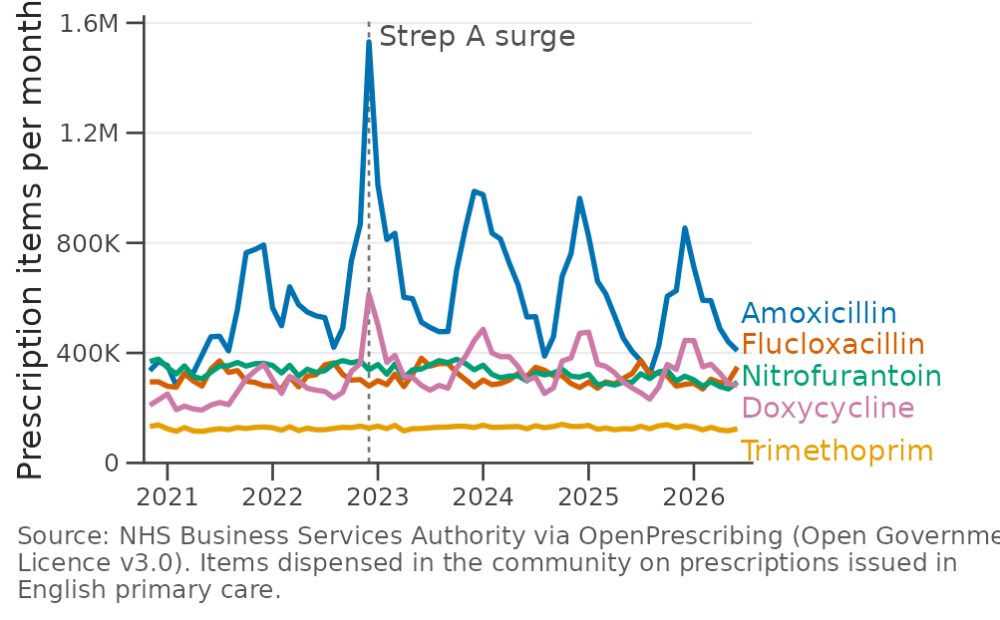

# Getting started with opamr

`opamr` has three parts:

1.  **A crosswalk** between antimicrobial names, `AMR` package codes,
    ATC codes and British National Formulary (BNF) chemical codes. It is
    bundled with the package and works offline.
2.  **Functions for the OpenPrescribing API**, which serves monthly
    prescribing data for English primary care by practice, Primary Care
    Network (PCN), Sub-ICB Location, ICB and region.
3.  **Figure functions** for prescribing time series, seasonality,
    variation between organisations and drug-by-month heatmaps, sized
    and styled for journals.

This vignette shows each part using only bundled data, so every chunk
runs without a network connection.
[`vignette("api", package = "opamr")`](https://vargasrichards.github.io/opamr/articles/api.md)
covers downloading data.

``` r

library(opamr)
```

## From antimicrobial names to BNF codes

Prescribing data are indexed by BNF code, while resistance data and the
`AMR` package use antimicrobial names, `AMR` codes or ATC codes.
[`ab_to_bnf()`](https://vargasrichards.github.io/opamr/reference/ab_to_bnf.md)
converts any of these:

``` r

ab_to_bnf(c("amoxicillin", "NIT", "J01AA02"), use_amr = FALSE)
#>         input  ab        ab_name     atc bnf_chemical_code
#> 1 amoxicillin AMX    Amoxicillin J01CA04         0501013B0
#> 2 amoxicillin AMX    Amoxicillin J01CA04         0501013C0
#> 3         NIT NIT Nitrofurantoin J01XE01         0501130R0
#> 4     J01AA02 DOX    Doxycycline J01AA02         0501030I0
#> 5     J01AA02 DOX    Doxycycline J01AA02         0501030Z0
#>                  bnf_name bnf_section           via
#> 1             Amoxicillin        0501 bundled table
#> 2      Amoxicillin sodium        0501 bundled table
#> 3          Nitrofurantoin        0501 bundled table
#> 4     Doxycycline hyclate        0501 bundled table
#> 5 Doxycycline monohydrate        0501 bundled table
```

One antimicrobial can have several BNF chemical codes, one for each salt
or formulation, such as the two doxycycline salts. ATC prefixes and
`AMR` group names select a whole class:

``` r

ab_to_bnf("J01MA", output = "codes")     # quinolones
#> [1] "0501120L0" "0501120P0" "0501120Q0" "0501120X0" "0501120Y0"
```

The reverse direction accepts any BNF level, from a 15-character
presentation code up to a section:

``` r

bnf_to_ab(c("0501013B0AAAAAA", "0501130R0"))[, c("input", "ab", "ab_name", "atc")]
#>             input  ab        ab_name     atc
#> 1 0501013B0AAAAAA AMX    Amoxicillin J01CA04
#> 2       0501130R0 NIT Nitrofurantoin J01XE01
```

[`vignette("crosswalk", package = "opamr")`](https://vargasrichards.github.io/opamr/articles/crosswalk.md)
describes how the crosswalk was built and where it stops.

## Prescribing data

The live functions return a tidy data frame with one row per code,
organisation and month:

``` r

use <- op_spending_ab(c("amoxicillin", "nitrofurantoin", "doxycycline"))       # England
sub <- op_antibiotic_use("co-amoxiclav", org_type = "sicbl", org = "02P")      # items per 1,000 patients
```

The bundled `op_example` dataset has the same layout as
[`op_spending_ab()`](https://vargasrichards.github.io/opamr/reference/op_spending_ab.md)
output. It covers national monthly totals for every antibacterial in BNF
section 5.1 from November 2020 to June 2026, aggregated from the NHS
Business Services Authority English Prescribing Dataset.

``` r

str(op_example)
#> 'data.frame':    3967 obs. of  11 variables:
#>  $ date       : Date, format: "2020-11-01" "2020-12-01" ...
#>  $ org_type   : chr  "national" "national" "national" "national" ...
#>  $ org_id     : chr  "england" "england" "england" "england" ...
#>  $ org_name   : chr  "England" "England" "England" "England" ...
#>  $ ab         : chr  "AMC" "AMC" "AMC" "AMC" ...
#>  $ ab_name    : chr  "Amoxicillin/clavulanic acid" "Amoxicillin/clavulanic acid" "Amoxicillin/clavulanic acid" "Amoxicillin/clavulanic acid" ...
#>  $ atc        : chr  "J01CR02" "J01CR02" "J01CR02" "J01CR02" ...
#>  $ code       : chr  "0501013K0" "0501013K0" "0501013K0" "0501013K0" ...
#>  $ items      : num  101252 106519 103371 92852 101757 ...
#>  $ quantity   : num  3801733 3996897 3896844 3461299 3780092 ...
#>  $ actual_cost: num  290883 307438 323383 288893 315606 ...
range(op_example$date)
#> [1] "2020-11-01" "2026-06-01"
```

The ten most-prescribed antibacterials over the period:

``` r

tot <- aggregate(items ~ ab_name, data = op_example, FUN = sum)
tot$share <- round(100 * tot$items / sum(tot$items), 1)
head(tot[order(-tot$items), ], 10)
#>                        ab_name    items share
#> 1                  Amoxicillin 41133222  23.1
#> 42              Nitrofurantoin 22487150  12.6
#> 24                 Doxycycline 21713878  12.2
#> 29              Flucloxacillin 21043648  11.8
#> 46     Phenoxymethylpenicillin 13547050   7.6
#> 18              Clarithromycin 10467906   5.9
#> 59                Trimethoprim  8680196   4.9
#> 2  Amoxicillin/clavulanic acid  7020572   3.9
#> 36                 Lymecycline  5089794   2.9
#> 8                    Cefalexin  4899738   2.8
```

## A first figure

``` r

top <- op_example[op_example$ab_name %in% c("Amoxicillin", "Doxycycline", "Nitrofurantoin",
                                            "Flucloxacillin", "Trimethoprim"), ]
op_plot_trend(top, y = "items",
              events = data.frame(date = "2022-12-01", label = "Strep A surge"))
```



Each line is labelled at its right-hand end, so there is no legend. The
colours come from the colour-blind-safe Okabe-Ito palette. The caption
cites the data source and licence.
[`op_save()`](https://vargasrichards.github.io/opamr/reference/op_save.md)
writes the figure at a journal column width:

``` r

p <- op_plot_trend(top, y = "items")
op_save(p, "figure1.pdf", width = "single")    # 85 mm wide; "onehalf" = 120 mm, "double" = 178 mm
```

[`vignette("figures", package = "opamr")`](https://vargasrichards.github.io/opamr/articles/figures.md)
covers all of the figure functions.

## What the data measure

- **Setting.** Items dispensed in the community on prescriptions issued
  in English primary care. Hospital inpatient use is not included.
- **Unit.** The prescription item, which says nothing about dose,
  duration or the patient. `quantity` is in product units (tablets, ml),
  so it cannot be compared across drugs.
- **Timeliness.** Data are published monthly, about two months after
  dispensing.
- **Licence.** Open Government Licence v3.0. Cite the NHS Business
  Services Authority and OpenPrescribing (Bennett Institute for Applied
  Data Science, University of Oxford).
